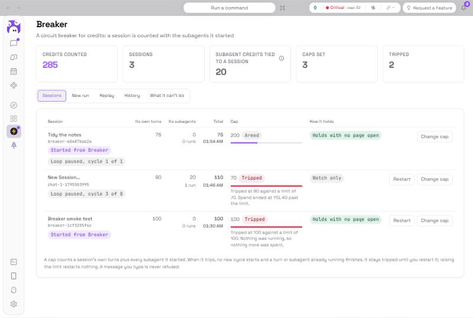
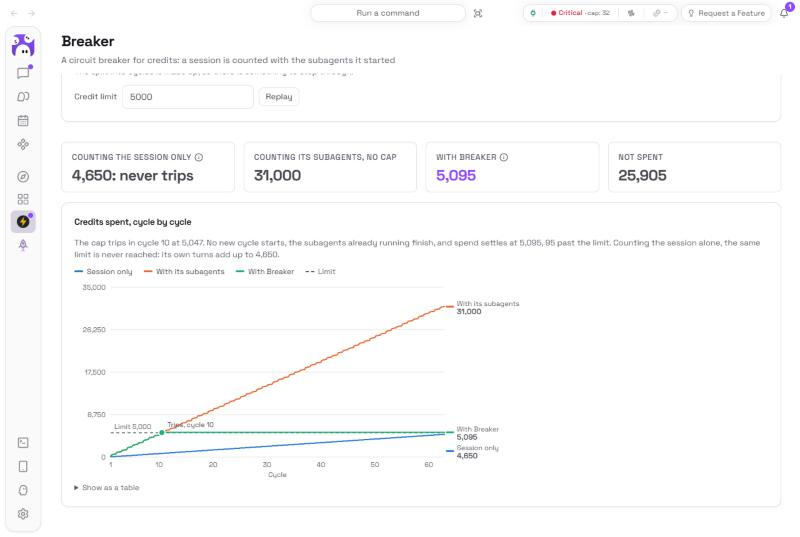

# Breaker

**A circuit breaker for credits in Kiro Crew.** It counts a session together with the subagents it started, trips at your limit, lets the running turn finish, and resets when you say.



Breaker is an app for [Kiro Crew](https://github.com/kirodotdev/KiroCrew) v0.13.1. It runs inside the gateway, on macOS, Linux and Windows.

## Why

Kiro Crew can work for hours with nobody watching: goal loops, crons, Task Runner jobs, subagents. As of v0.13.1 it bounds that work by cycles and by time, not by credits.

- **The request:** [KiroCrew#6338](https://github.com/kirodotdev/KiroCrew/issues/6338) asks for a credit ceiling that pauses the work, tells the owner, and lets them resume. One report there describes a goal loop that carried a 5,000-credit budget in its own notes and spent about 31,000 in two and a half days, about 85% of it in subagents.
- **The design:** [KiroCrew#35488](https://github.com/kirodotdev/KiroCrew/pull/35488) is a request for change that works the fix out for Crew's core. First charge a subagent's credits to the session that spawned it, then stop an unattended loop at a turn boundary once that total passes a cap. The design is its authors', and it is waiting on a maintainer's sign-off.

Breaker is that design tried out on the released version, as an opt-in app, using only what an app is allowed to use. Where an app can't do what the design asks, Breaker says so on its own page and names what Crew would have to offer.

## What it does

**1. A true session total.** A subagent's usage row doesn't say which session started it, so a session's total leaves its subagents out. Breaker catches that link while the subagent is running and keeps it. It also shows how much subagent spend it could tie to a session and how much it couldn't.

**2. A shadow cap.** Set a limit on any session in shadow mode. Breaker evaluates it after every turn and stops nothing. It records when the cap would have tripped, what was still running, and how far spend ran past it.

**3. A real cap, labelled by how well it holds.**

| Label on the page | Which work | How it stops |
|---|---|---|
| **Holds with no page open** | Work you start from Breaker's "New run" tab | Breaker owns the session and its goal loop. At a trip it removes the loop, so no further cycle starts. |
| **Holds while a Breaker page is open** | A goal loop you started yourself | Only the owner may pause that loop. Breaker's page, which acts as you, pauses it. The backend queues the stop and the open page carries it out. |
| **Watch only** | Everything else | Breaker records the trip and shows it. |

**4. Replay.** The totals reported on #6338, run through the same code Breaker uses live. Counting only the session's own turns, a 5,000 cap never trips: they add up to 4,650. Counting its subagents, the cap trips in cycle 10 at 5,047, the subagents already running finish, and spend settles at 5,095 instead of 31,000. The split into cycles is made up, and the page says so.



Rules it keeps, all taken from the design:

- **Drain, don't cut.** A turn or subagent that is already running finishes. No new cycle starts.
- **A tripped cap stays tripped** until the owner restarts the work. Raising the limit restarts nothing.
- **A message you type always runs.** Caps are for unattended work.
- **It fails open.** If Breaker can't read the meter, it says so and stops nothing.
- **Credits only.** A session on a backend that bills in dollars is listed and never capped.

## Install

```
kirocrew app install https://github.com/OracleOfAggieland/crew-breaker
```

Then open the app's page in the dashboard (Discover, or `/apps/detail/breaker`), press Enable and accept the trust prompt. Kiro Crew asks because a third-party app's backend runs inside the gateway with the gateway's own access. The prompt lists what Breaker asks for:

- chat sessions of its own, for work started from Breaker;
- `GET /api/sessions/memory`, to see running subagents and their parent sessions;
- `/api/autonudge`, to see goal loops and, from the page, to pause one;
- its own routes under `/api/apps/breaker`.

Breaker reads Crew's usage files (`usage/tokens/*.jsonl` under the data home) and writes only to its own data folder.

## Use

- **Sessions** lists every session that has spent credits: its own turns, its subagents, the total, and its cap. "Set cap" takes a limit and a mode (Shadow or Enforce).
- **New run** starts work under a breaker: a goal, a credit limit, the most cycles, and the idle time between cycles. This is the only kind of cap that holds with no page open.
- **Replay** steps through the #6338 numbers at any limit.
- **History** lists every warning, trip and stop.
- **What it can't do** lists the limits below.

After a trip, raise the limit if you want more spend, then press Restart. Restart on a run Breaker started arms its loop again for the cycles that were left.

## What it can't do

- **Refuse a turn before it starts,** except on work it owns. An app has no hook in front of a turn. A cap on your own loop holds by pausing the loop, and only while a Breaker page is open.
- **Cut a running turn or subagent.** Spend can run past the limit while they finish. Breaker measures that and shows it.
- **Stop a finished subagent from waking its session.** That turn can start more subagents with no loop cycle involved. Breaker stops the loop, not that wake.
- **Tie a subagent to its session if it never saw it running.** Breaker looks every 10 seconds. A subagent that starts and ends between two looks is counted and listed with its session unknown.
- **See a top-level turn in flight.** Crew writes a turn's credits when the turn ends. Only running subagents report spend as they go.
- **Cap dollars.** Credits only.

**What an app would need from Kiro Crew to do the rest:**

- the parent session written on each subagent's usage row;
- a check an app can answer before a loop's next cycle, so a cap holds on any loop with no page open;
- a stop reason an app can set on a loop it paused;
- the same check before a subagent is spawned.

## How it's built

- **A pure core** (`backend/breaker_core`): the ledger that folds usage rows and live snapshots into a total per session, the cap, and the replay. No I/O and no clock of its own. A run counts as the larger of its settled rows and its highest live figure, so a credit is never counted twice.
- **A backend** inside the gateway (`backend/`): reads the meter every 5 seconds, decides, stops what it is allowed to stop, and saves its state. It imports nothing from Kiro Crew. If a route or a handle it needs is missing, that feature is off and the page says so.
- **A page** (`ui/`) on the Crew app SDK, built to one file that is committed (`ui/dist/index.mjs`).
- **The design note** is [docs/design.md](docs/design.md).

## Tests

```
python -m venv .venv
.venv/Scripts/pip install -r dev-requirements.txt     # .venv/bin/pip on macOS and Linux
.venv/Scripts/python -m pytest -q
```

44 tests. Twelve are properties checked with Hypothesis over random histories of turns, subagents, late parent links and garbage readings. Among them:

- a total never goes down, and every credit lands in exactly one session's total;
- a row is counted once however often it is read;
- a run is never counted by both its rows and its live figure;
- a tripped cap stays tripped until the owner restarts, and raising the limit restarts nothing;
- a bad meter reading moves nothing and trips nothing;
- shadow mode never stops anything.

One counterexample they found is kept as a test: a credits field holding the text `"12"` was being counted as 12 credits. Text is now refused, not read as a number.

The rest run the backend against real usage files in a temporary folder and a stand-in gateway.

## Trying it without spending credits

`dev/credit_backend.py` wraps the fake model backend that ships with Kiro Crew's own tests and adds the one frame kiro-cli sends to report a turn's credits. Point a development gateway's `KIROCREW_KIRO_BIN` at a script that runs it, and Crew writes real usage rows with no account, sign-in or credit used. A prompt can set what its turn bills (`credits=40`) and how long it runs (`sleep=30`).

## What has been checked, and what hasn't

Checked on Nov 24, 2026 in a real Kiro Crew v0.13.1 gateway on Windows, on the stand-in backend above:

- **Install and trust.** The app installs, the trust prompt lists exactly the permissions above, and the backend's hooks load.
- **A run Breaker started.** With a limit of 100 it was warned at 88 and tripped at 100. Breaker removed its loop (Crew's log: `stopped — reason='credit_cap' (cycles 5/6)`), and nothing was billed afterward.
- **A loop the owner started.** With a limit of 70 and a loop billing 30 a cycle, the cap tripped at 90. The open Breaker page paused the loop one second later, at cycle 3 of 8, and nothing was billed afterward.
- **A real subagent.** A session at 90 credits started a subagent. Breaker showed it under that session while it ran, counted its first 10 credits live (total 100), and settled at 110 when its row was written. That row names no parent.
- **The page.** All five tabs, the cap editor, the New run form and Restart.

Not checked:

- **Real kiro-cli billing.** Every credit above came from the stand-in. It reports credits in the frame Crew's source reads them from, and nothing has run on a real Kiro account.
- **macOS and Linux.** The code has no Windows-only path, and it has only run on Windows.
- **A gateway restart in the middle of a run,** beyond the unit test that saves and reloads the state.
- **Many subagents at once, and subagents of subagents,** beyond the property tests.
- **A large usage log.** The reader keeps its place in each file, and its speed on months of rows is unmeasured.

## Who built it

Matt Avila directed it. The code, tests and documents were written by Claude Code (Anthropic's coding agent). No file in this repo was written by Kiro.

## License

[MIT](LICENSE)
